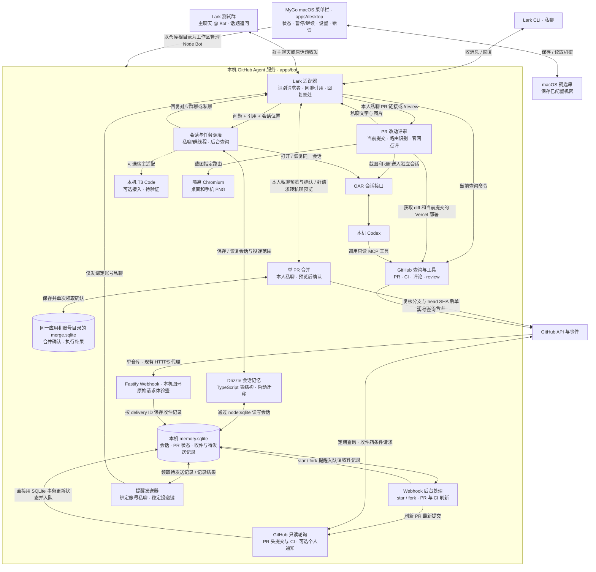

# GitHub Activity Bot 架构

通过 Lark 私聊或群聊查询 GitHub PR、CI、评审和评论。MyGo 菜单栏管理本机 Node Bot，OAR 在本机启动并恢复 Codex 会话。

## 整体结构

实线表示已有实现，虚线表示计划中的宿主适配。[安装、配置与联调说明](../README.md)

## 仓库与启动方式

| 位置 | 职责 |
| --- | --- |
| [apps/bot](../apps/bot) | Node Bot、Lark 适配器、GitHub 查询、Codex 工具、提醒与合并流程 |
| [apps/desktop](../apps/desktop) | MyGo 菜单栏、设置、macOS 钥匙串与 Bot 进程管理 |
| [仓库根目录](../package.json) | pnpm 工作区入口，提供 `pnpm lark`、`pnpm prs` 与 `pnpm desktop:build` |

MyGo 和 CLI 都以仓库根目录为 Bot 的工作目录。桌面端优先启动 `apps/bot/src/lark.ts`，旧布局回退到 `src/lark.ts`。桌面设置和钥匙串中的非空值优先，其次为继承的环境变量，再读取根目录 `.env`。暂停会通知 Bot 退出，恢复会重新启动并连接 Lark。重启会等待旧进程退出。[桌面进程管理](../apps/desktop/controller.go) · [配置与凭据](../apps/desktop/internal/settings/settings.go)

## Lark 对话与投递

| 入口 | 请求处理 |
| --- | --- |
| 本人私聊 | 可直接问，也可引用同聊的文本、富文本或合并转发。引用读不到时，使用附言里的明确 PR，或请本人贴链接。 |
| 本人私聊单个 PR 链接或 /review | 核对当前提交并读取改动。前端输出桌面和手机截图及布局点评，后端输出改动范围。 |
| 本人在群里 @ Bot | 即时回复「好的，收到！」，普通问答的结果接着在群聊原处发出。 |
| 本人引用群消息并 @ Bot | 只 @ 时，概括同事的请求，能确定 PR 时查实时 CI 与评审，并建议下一步。带附言时按附言处理。 |
| 已登记群线程追问 | 绑定账号在同一线程继续使用该线程的会话。 |
| 本人在群里 @ Bot 并明确请求合并 | 预览或缺少的信息发给绑定账号的私聊，在群聊原处告知投递状态。 |

Lark 适配器核对绑定账号、群聊范围和回复位置，使用消息 ID 读取同聊引用。引用内容作为上下文，操作意图来自本人消息。群聊和私聊分别排队与恢复会话。群聊原处接收普通问答和已确认公开的仓库查询结果。私有仓库、可见性未知和个人 PR 列表在群里提示改用私聊查询。[私聊路由](../apps/bot/src/lark-handler.ts) · [群聊路由](../apps/bot/src/lark-group.ts) · [群结果投递](../apps/bot/src/lark-group-work.ts)

OAR 为 Codex 注入 `list_my_open_prs`、`get_pull_request`、`list_pr_checks` 和 `get_pull_request_reviews` 四个只读 MCP 工具。查询凭据留在宿主，Codex 启动时移除继承的凭据环境变量。[OAR 与 MCP](../apps/bot/src/agent.ts) · [GitHub 查询](../apps/bot/src/github.ts)

PR 评审从 GitHub 部署记录选取当前 head 的成功 Vercel 预览，在隔离浏览器以两个尺寸截图。独立 Codex 会话分析 diff 和图片。发送前再次核对 PR 的 head。截图只发绑定账号，临时文件在评审后清理。[评审流程](../apps/bot/src/pull-request-review.ts) · [预览截图](../apps/bot/src/preview-capture.ts)

## 单个 PR 合并

1. 本人在私聊或已配置群内发起明确的合并请求。Bot 从附言或引用中识别唯一 PR，读取目标分支、head SHA、CI 和评审结果。
2. 允许合并的仓库使用专用的 `GH_MERGE_TOKEN` 和 `GH_MERGE_REPOSITORIES`。预览与确认指令只发私聊，确认码有效期 10 分钟。私聊发起的预览绑定原私聊，群发起的预览绑定同一个应用下本人的私聊身份。
3. 本人私聊确认后，宿主原子领取确认码并复核目标分支、head SHA 和合并方式。GitHub 接口按 head SHA 做写入校验。确认码最多触发一次请求，请求结果不明时提示核对 GitHub。

[合并流程](../apps/bot/src/lark-merge.ts) · [确认记录](../apps/bot/src/lark-merge-store.ts) · [GitHub 合并客户端](../apps/bot/src/github-merge.ts)

## GitHub 主动提醒

| 来源 | 覆盖与投递 |
| --- | --- |
| CI 轮询 | 关注本人发起、显式跟踪和个人通知发现的 PR，首次建立基线。状态变化时以当前 head SHA 为准。 |
| 个人通知 | 配置通知凭据后轮询近期相关线程，按 GitHub 返回的间隔处理，覆盖评审请求、提及和评论等。 |
| GitHub App Webhook | 一个已配置仓库。现有 HTTPS 代理转发到本机回环 Fastify。原始请求体验签后，按 delivery ID 写入收件记录。star、fork 可直接入队，PR 和 CI 事件触发只读刷新。 |

启用提醒需设置 `LARK_GITHUB_ALERTS=1`。CI 轮询和 Webhook 共用状态与去重规则。状态变更和待发送记录在同一个 SQLite 事务里写入。发送器使用稳定的投递 UUID，重启后继续处理明确待发的记录，暂时无法判断发送结果的记录保留供核对。[Webhook 接入](../apps/bot/src/github-webhook.ts) · [提醒后台](../apps/bot/src/github-alert-worker.ts) · [状态和去重](../apps/bot/src/github-alert-store.ts)

## 本地数据

| 数据 | 位置与用途 |
| --- | --- |
| `memory.sqlite` | 由 Lark 应用和绑定账号隔离。Drizzle 保存原生会话 ID、群线程路由和群聊结果可见性标记。提醒后台用 SQLite 事务保存 CI 观测、个人通知游标、Webhook 收件和待发送记录。 |
| `merge.sqlite` | 同一身份目录内的合并确认、预览快照和执行结果。 |
| Codex 会话正文 | 由 Codex 原生会话维护。Bot 用存下的会话 ID 续接。 |

Bot 数据默认位于 `~/.local/state/github-activity-bot`，可用 `LARK_MEMORY_DIR` 覆盖。Drizzle 迁移随 Bot 启动执行。[会话记忆](../apps/bot/src/lark-memory.ts) · [迁移](../apps/bot/drizzle/memory)

## 验证进度

- Node 24 和 26 各通过 70 项测试，覆盖引用、会话恢复、群聊分流、合并确认、提醒和 Webhook。Go 进程管理通过竞态检查，Apple Silicon 应用已打包验证。
- 真实测试群、MyGo 对真实 Lark Bot 的切换、真实 GitHub 合并、个人通知与 GitHub App Webhook 的完整投递待联调。
- 待设计的能力包括未完成问答的持久化恢复、明确配置的长期偏好、可选 T3 宿主，以及合并队列和堆叠 PR。
